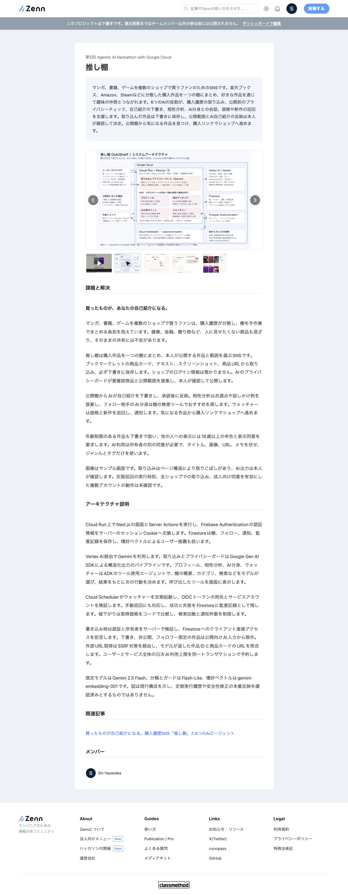

# Zenn応募フォームの保存記録

2026年10月14日、接続済みChromeでプロジェクト「推し棚」、ID `a7bd14545ff6f9` を確認し、Issue #32の入力と保存を実施しました。
最終提出は行っておらず、表示は「未提出」です。

## 保存と確認の結果

| タブ | 保存した内容 | 確認結果 |
| --- | --- | --- |
| プロジェクト概要 | 名前「推し棚」を維持。概要242文字 | 保存後の再読み込みを経て、概要欄と紹介ページで保持を確認 |
| プロジェクト紹介 | 課題と解決603文字、構成説明737文字、画像3枚、構成図、動画URL、既存記事URL | 保存後に再読み込みし、文章、画像数、図、URLの保持を確認。両欄のMarkdownプレビューと紹介ページを確認 |
| 審査向け情報 | 既存デプロイURLを維持。デモボタンによるログイン、架空サンプル、操作手順、5〜10分の目安、利用上限と未確認事項を入力 | 保存成功表示と再読み込み後の保持を確認。`ShinHaya/oshishelf` のGitHub連携が表示され、権限操作は不要 |

[保存文面](zenn-dashboard-copy.md)はフォームに保存した内容です。
ログインはデモボタンで案内し、メールアドレスやパスワードは新しい文面と記録画像へ転載していません。

## 登録したURLと画像

- [デプロイ先](https://oshi-dana.com)
- [公開動画](https://youtu.be/o4LUiTS3IsU)
- [公開記事](https://zenn.dev/sinhayasaka/articles/0beb2b047542c2)
- [紹介ページ](https://zenn.dev/hackathons/google-cloud-japan-ai-hackathon-vol5/projects/a7bd14545ff6f9)

プロジェクト画像には `docs/images/01-landing.png`、`02-feed.png`、`03-profile-compat-twin.png` を使いました。
5枚すべてを目視し、公開前の商品情報を含む `04-privacy-guard.png` と、古い巡回結果や新作情報を含む `05-watcher.png` は登録対象から外しました。
画像はサンプル画面であることを紹介文に明記しています。
構成図には `docs/architecture.png` を使い、紹介ページで欠けや重なりがなく表示されることを確認しました。
動画は紹介ページで正しいタイトルのYouTubeプレーヤーが埋め込まれ、関連記事は公開記事のタイトルとリンク先が一致しています。

## 最終提出への引き継ぎ

Issue #32の入力項目は保存済みです。
最終提出ボタンは押していません。
Issue #29で提出直前の内容確認、必須項目と最終送信を扱います。

今回、アプリやクラウド設定は変更していません。
動画のログアウト状態での再生、定期巡回の実行時刻、全ショップでの取り込み、成人向け同意を有効にした複数アカウントの動作、安全性修正の本番反映は確認していません。
これらを実証済みと書かないよう、紹介文と審査手順にも制限を残しています。

## リポジトリの検査とレビュー

Node.js 22.23.1で `pnpm check`（18ファイル、266テスト）と `pnpm build` が成功しました。
`git diff --check` も成功しています。
今回の変更は文面と確認記録のため、形式的な追加テストは作成していません。
差分をAIが確認し、保存と最終提出の区別、認証情報の非転載、未確認事項、既存資料との整合を確認しました。
認証、公開範囲、AI入力、外部取得、利用上限、データ削除の実装変更はありません。
ローカルAIレビューのpost-commit hookは設定されていないため、自動レビューは実行していません。

## Issue #61の下書き修正（2026年10月15日）

利用者の指示により、今回はGitHubの下書きを修正し、著者の文章確認後にZennへ反映します。
[文面](zenn-dashboard-copy.md)の冒頭に未反映であることを明記しました。
10月14日の保存と確認の結果は上記の記録を維持しています。

アーキテクチャ説明を、取り込み、本人確認と公開、趣味の合う人や作品の発見という操作の流れで書き直しました。
商品カードにあるURLと画像の照合、要確認商品の選択解除、自己紹介の承認を説明し、インフラリソース単位の対策の説明を省きました。
嗜好ベクトルには成人向けを除く全体公開作品のカテゴリ、頻出タグ、作品名を使うことを現行コードで確認し、ユーザー候補の検索とADKによる相性分析、作品推薦を区別しました。
精度の改善率は記載せず、定量比較が未実施であることと、ベクトル更新を試みるタイミングを明記しました。

審査用IDとパスワードは、著者確認後にZennの審査向け欄へ記入します。
下書きには入力位置と未反映の状態を編集用注記として残し、注記はZennへ貼り付けないことを明記しています。
今回の差分に認証情報の実値は含めていません。

Zennの保存、再読み込み後の保持、文字数制限、プレビューと審査向け欄の公開範囲は未確認です。
アプリの操作やAI出力品質、本番反映も今回の検証対象に含めていません。
実サイト反映後に保存結果を追記するため、Issue #61は完了扱いにしません。

Node.js 22.23.1とCIと同じ架空のFirebase公開設定で、`pnpm check`（25ファイル、300テスト）と`pnpm build`が成功しました。
初回の検査はFirebase公開設定の不足で型生成時に停止したため、架空設定を指定して再実行しました。
`git diff --check`も成功しています。
文面と作業記録のみの変更のため、形式的なテストは追加していません。
差分を自己レビューし、公開範囲と成人向けAI入力、推薦の仕組み、認証情報の非転載、保存前の状態表示に未解決の指摘はありません。
post-commit hookは未設定で、フックによるローカルAIレビューは実行されません。

## Issue #61のZenn反映（2026年10月15日）

著者がGitHubで修正した `ea1db2f` の文面を基に、ログイン済みChromeで概要、課題と解決、アーキテクチャ説明、動作確認の方法を保存しました。
アーキテクチャ説明はフォームの800文字制限を確認したため、取り込みと公開の流れ、嗜好ベクトルの入力の工夫、相性分析との役割分担を残して750文字に短縮しました。
[文面](zenn-dashboard-copy.md)も保存内容に合わせて更新しています。
概要は259文字、課題と解決は468文字です。
各欄は再読み込み後に保持を確認し、紹介のMarkdownプレビューと紹介ページで表示を確認しました。
既存の画像3枚、構成図、動画URL、記事URLを維持しています。

審査向け欄には「審査と運営目的でのみ使用され、一般には公開されない」と表示されていることを確認し、審査用IDとパスワードを記入しました。
保存後の再読み込みで入力全文の一致を確認しました。
編集用注記は貼り付けていません。
認証情報の実値はGitHubの文面と記録画像には残していません。

提出状態は「未提出」で、紹介ページには下書きの案内が表示されています。
今回は本番Zennへの保存までを行い、最終提出ボタンは押していません。
ログアウト状態での表示やアプリ操作、AI出力品質、本番デプロイ状況は再検証していません。

反映後の文面と記録の差分を自己レビューし、認証情報の非転載、文字数制限、保存と最終提出の区別を確認しました。
Node.js 22.23.1と架空のFirebase公開設定で`pnpm check`（25ファイル、300テスト）と`pnpm build`を再実行し、成功しました。
`git diff --check`も成功しました。
アプリコードの変更と追加テストはありません。
post-commit hookは未設定のため、フックによるローカルAIレビューは実行されません。
